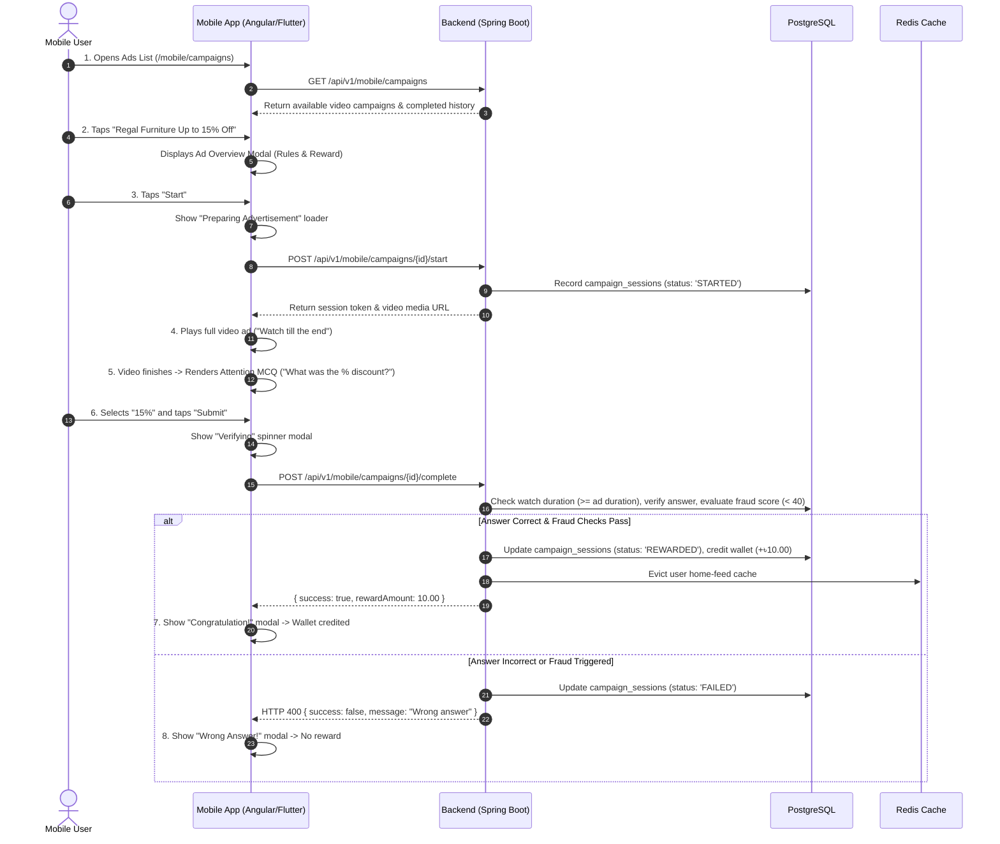

# Video Ad Earning Flow — User & Developer Guide

## Table of Contents
1. [Overview & Flow Architecture](#1-overview--flow-architecture)
2. [Screen-by-Screen UI & Component Breakdown](#2-screen-by-screen-ui--component-breakdown)
   - [Screen 1: Ad List (On-going & Completed Ads)](#screen-1-ad-list-on-going--completed-ads)
   - [Screen 2: Ad Overview Modal / Bottom Sheet](#screen-2-ad-overview-modal--bottom-sheet)
   - [Screen 3: Preparing Advertisement (Buffering Loader)](#screen-3-preparing-advertisement-buffering-loader)
   - [Screen 4: Watch Ad Video Playback](#screen-4-watch-ad-video-playback)
   - [Screen 5: Post-Roll Verification MCQ](#screen-5-post-roll-verification-mcq)
   - [Screen 6: Verifying Loader Modal](#screen-6-verifying-loader-modal)
   - [Screen 7: Congratulations / Success Modal](#screen-7-congratulations--success-modal)
   - [Screen 8: Wrong Answer / Failure Modal](#screen-8-wrong-answer--failure-modal)
3. [Frontend UI Paths & Navigation Guide](#3-frontend-ui-paths--navigation-guide)
4. [Backend API Reference](#4-backend-api-reference)
5. [Data Insertion Guide (Where & How to Insert Data)](#5-data-insertion-guide-where--how-to-insert-data)
   - [5.1 Admin Portal UI](#51-admin-portal-ui)
   - [5.2 Admin REST API (cURL / Postman)](#52-admin-rest-api-curl--postman)
   - [5.3 Direct PostgreSQL Database Insertion](#53-direct-postgresql-database-insertion)
6. [Ready-to-Run SQL Seed Script (Exact Match to Screens)](#6-ready-to-run-sql-seed-script-exact-match-to-screens)
7. [Anti-Fraud, Watch-Time & Answer Verification Rules](#7-anti-fraud-watch-time--answer-verification-rules)
8. [Troubleshooting & FAQ](#8-troubleshooting--faq)

---

## 1. Overview & Flow Architecture

The **Video Ad Earning Flow** enables users to earn wallet rewards by viewing sponsored video advertisements from brand advertisers. To guarantee advertiser ROI and prevent bot fraud, the flow enforces mandatory full-length playback, anti-skip verification, post-roll attention check MCQs, and automated fraud score evaluations before crediting wallet rewards.



---

## 2. Screen-by-Screen UI & Component Breakdown

### Screen 1: Ad List (On-going & Completed Ads)
* **Visual Elements:**
  - Header: Back arrow `<` and title **Ads**
  - Top Metric Cards: **৳ 60 Today's Earning** (Gold) & **04 Remaining Ad** (Gold)
  - Section **On going Ad**:
    - Card 1: *Regal Furniture Up to 15% Off - Video Ad* (Takes approx 2 min, `+ ৳10.00`)
    - Card 2: *Apex Footwear September Offer - Video Ad* (Takes approx 2 min, `+ ৳10.00`)
    - Completed Card 1: *Apex Footwear September Offer - Video Ad* (Blue checkmark icon, *"Completed this task successfully and earned ৳10.00"*)
    - Completed Card 2: *Apex Footwear September Offer - Video Ad* (Blue checkmark icon)
  - Bottom Navigation Bar: **Home**, **Uparjon** (Active), **Wallet**, **Menu**
* **Frontend Route:** `http://localhost:4200/mobile/campaigns`

---

### Screen 2: Ad Overview Modal / Bottom Sheet
* **Visual Elements:**
  - Modal Header: **Overview** with close `X` button
  - Ad Icon & Title: *Regal Furniture Up to 15% Off - Video Ad*
  - **Before you start:**
    - Watch the video till the end
    - Answer the question correctly
    - You can't skip the video
  - **Reward:**
    - Answer all the questions correctly to receive `৳10.00`. The reward will be added to your wallet after verification.
  - Action Buttons: **Back** (Ghost) & **Start** (Gold Primary).

---

### Screen 3: Preparing Advertisement (Buffering Loader)
* **Visual Elements:**
  - Header: Back arrow `<`
  - Center Graphic: Animated Play / Video loader icon with glowing concentric rings
  - Title: **Preparing Advertisement**
  - Subtitle: *"Please wait a moment"* (Pre-fetches video stream and initializes anti-fraud tracking session).

---

### Screen 4: Watch Ad Video Playback
* **Visual Elements:**
  - Header: Back arrow `<` and title **Watch Ad**
  - Video Player: High-definition streaming video player showing the brand ad (*Regal Furniture*)
  - Playback Controls: Progress timeline bar, current timestamp vs duration, unskippable lock
  - Bottom Instruction:
    - **Watch till the end**
    - Subtext: *"After the video, a question will appear. To earn the reward you need to answer the question correctly."*

---

### Screen 5: Post-Roll Verification MCQ
* **Visual Elements:**
  - Header: Back arrow `<` and title **Watch Ad**
  - Question Prompt: *"What was the percentage of discount on the Ad?"*
  - Radio Choices:
    - `10%`
    - `15%` (Selected with gold outline and filled radio dot)
    - `20%`
    - `25%`
  - Action Buttons: **Back** and **Submit** (Gold Primary Button).

---

### Screen 6: Verifying Loader Modal
* **Visual Elements:**
  - Modal Dialog with close `X`
  - Center Graphic: Hourglass / Pending icon inside yellow circle (`hourglass_top`)
  - Title: **Verifying**
  - Subtitle: *"Please wait while we verify your answer"* (Validates answer payload against backend key).

---

### Screen 7: Congratulations / Success Modal
* **Visual Elements:**
  - Modal Dialog with close `X`
  - Center Graphic: Confetti / Party Popper inside green circle
  - Title: **Congratulation!**
  - Subtitle: *"Your answer is correct. Your reward will be added to your wallet."*
  - Action Button: **Continue** (Gold Primary) -> Credits wallet with `+৳10.00` and navigates back to Ad list.

---

### Screen 8: Wrong Answer / Failure Modal
* **Visual Elements:**
  - Modal Dialog with close `X`
  - Center Graphic: Red `X` inside red circle (`cancel` / `error`)
  - Title: **Wrong Answer!**
  - Subtitle: *"Your answer is not correct. You didn't earn the reward this time."*
  - Action Button: **Continue** (Gold Primary) -> Navigates back to Ad list without wallet reward.

---

## 3. Frontend UI Paths & Navigation Guide

### 3.1 Web & Mobile Preview URLs

| UI Screen | Web URL Path | Component Reference | Access Role |
| :--- | :--- | :--- | :--- |
| **Ads List (Screen 1)** | `http://localhost:4200/mobile/campaigns` | [MobileCampaignPage](file:///d:/personal/uparjon/platform/frontend/src/app/mobile-preview/pages/campaigns/campaigns.ts) | Mobile User |
| **Tasks Hub (Alternative Entry)** | `http://localhost:4200/mobile/tasks` | [MobileTaskBoardPage](file:///d:/personal/uparjon/platform/frontend/src/app/mobile-preview/pages/tasks/tasks.ts) | Mobile User |
| **Admin Campaigns Workspace** | `http://localhost:4200/w/advertising/campaigns` | Admin Campaign Workspace | Admin |
| **Admin Creatives & Banners** | `http://localhost:4200/w/advertising/creative` | Admin Creative Workspace | Admin |

### 3.2 Test Accounts

| Role | Email | Password | Dev OTP | Purpose |
| :--- | :--- | :--- | :--- | :--- |
| **End User (KYC)** | `kyc@test.com` | `Password@123` | `123456` | Watch video ads and receive wallet rewards |
| **Standard User** | `user@test.com` | `Password@123` | `123456` | Watch video ads |
| **Platform Admin** | `admin@test.com` | `Password@123` | `123456` | Create video campaigns, ads & set budgets |

---

## 4. Backend API Reference

Base URL: `http://localhost:8080`  
Header: `Authorization: Bearer <JWT_TOKEN>`

### 4.1 List Eligible Video Ad Campaigns (Screen 1)
* **Endpoint:** `GET /api/v1/mobile/campaigns`
* **Controller:** [MobileCampaignController.java](file:///d:/personal/uparjon/platform/src/main/java/com/uparjonx/platform/campaigns/controllers/MobileCampaignController.java)
* **Description:** Returns all active campaigns the current user is eligible to watch.

**Response (`200 OK`):**
```json
{
  "success": true,
  "message": "Campaigns retrieved successfully",
  "data": {
    "content": [
      {
        "id": "c1000001-0000-4000-8000-000000000001",
        "title": "Regal Furniture Up to 15% Off - Video Ad",
        "thumbnailUrl": "https://images.unsplash.com/photo-1555041469-a586c61ea9bc?w=800",
        "type": "VIDEO",
        "rewardAmount": 10.00,
        "durationSeconds": 30,
        "status": "ACTIVE"
      },
      {
        "id": "c1000001-0000-4000-8000-000000000002",
        "title": "Apex Footwear September Offer - Video Ad",
        "thumbnailUrl": "https://images.unsplash.com/photo-1542291026-7eec264c27ff?w=800",
        "type": "VIDEO",
        "rewardAmount": 10.00,
        "durationSeconds": 30,
        "status": "ACTIVE"
      }
    ]
  }
}
```

---

### 4.2 Get Campaign Details & Instructions (Screen 2)
* **Endpoint:** `GET /api/v1/mobile/campaigns/{id}`
* **Controller:** `MobileCampaignController.getCampaignDetails(id)`

**Response (`200 OK`):**
```json
{
  "success": true,
  "message": "Campaign details retrieved successfully",
  "data": {
    "id": "c1000001-0000-4000-8000-000000000001",
    "title": "Regal Furniture Up to 15% Off - Video Ad",
    "description": "Watch the video ad completely and answer the question to earn rewards.",
    "image": "https://images.unsplash.com/photo-1555041469-a586c61ea9bc?w=800",
    "instructions": "1. Watch the video ad completely.\n2. Complete the required tasks.\n3. Claim your reward.",
    "rewardAmount": 10.00,
    "estimatedDuration": 30,
    "eligible": true,
    "adId": "a1000001-0000-4000-8000-000000000001",
    "adType": "QUIZ",
    "videoUrl": "https://api.avytor.com/api/v1/files/download/regal-promo.mp4",
    "thumbnailUrl": "https://images.unsplash.com/photo-1555041469-a586c61ea9bc?w=800",
    "passingScore": 100,
    "maxAttempts": 3,
    "questions": [
      {
        "id": "q1000001-0000-4000-8000-000000000001",
        "questionText": "What discount did Regal Furniture offer?",
        "questionType": "SINGLE_CHOICE",
        "isRequired": true,
        "orderIndex": 0,
        "options": [
          { "id": "o1000001-0000-4000-8000-000000000001", "optionText": "15%" },
          { "id": "o1000002-0000-4000-8000-000000000002", "optionText": "5%" }
        ]
      }
    ]
  }
}
```

* `videoUrl` is the media to play and `adId` is used for `POST /api/v1/mobile/ads/{adId}/view` and `POST /api/v1/quizzes/submit`.
* `questions` is empty for plain `VIDEO` ads. Options never include the correct answer; the server grades submissions.

---

### 4.3 Start Ad Playback Session (Screen 3 → Screen 4)
* **Endpoint:** `POST /api/v1/mobile/campaigns/{id}/start`
* **Controller:** `MobileCampaignController.startCampaign(id)`
* **Description:** Initializes an anti-fraud tracking session in `campaign_sessions` with `started_at = NOW()`.

**Response (`200 OK`):**
```json
{
  "success": true,
  "message": "Campaign session started successfully",
  "data": {
    "sessionId": "sess0001-0000-4000-8000-000000000001",
    "startedAt": "2026-08-25T22:45:00"
  }
}
```

---

### 4.4 Complete Ad & Verify MCQ (Screen 5 → Screen 6 → Screen 7/8)
* **Endpoint:** `POST /api/v1/mobile/campaigns/{id}/complete`
* **Controller:** `MobileCampaignController.completeCampaign(id)`
* **Description:** Verifies minimum watch duration (fraud defense), validates user risk score, deducts campaign remaining budget, atomically credits `wallets.approved_balance` (`+৳10.00`), records reward history, and marks session `REWARDED`.

**Success Response (`200 OK`):**
```json
{
  "success": true,
  "message": "Campaign session completed successfully",
  "data": {
    "sessionId": "sess0001-0000-4000-8000-000000000001",
    "startedAt": "2026-08-25T22:45:00"
  }
}
```

---

## 5. Data Insertion Guide (Where & How to Insert Data)

### 5.1 Admin Portal UI
1. Log in to `http://localhost:4200/w/advertising/campaigns` with `admin@test.com`.
2. Click **Create Campaign**:
   - **Campaign Title:** `Regal Furniture Up to 15% Off - Video Ad`
   - **Total Budget:** `50000.00`
   - **Status:** `ACTIVE`
3. Attach Video Ad & Creatives at `/w/advertising/creative`:
   - **Media URL:** Video streaming file URL (`.mp4` / HLS).
   - **Thumbnail URL:** Image preview URL.
   - **Reward Amount:** `10.00`
   - **Duration:** `30` seconds.
4. Save and Publish.

---

### 5.2 Admin REST API (cURL / Postman)

```bash
# 1. Create Campaign
curl -X POST http://localhost:8080/api/v1/campaigns \
  -H "Authorization: Bearer <ADMIN_JWT_TOKEN>" \
  -H "Content-Type: application/json" \
  -d '{
    "title": "Regal Furniture Up to 15% Off - Video Ad",
    "description": "Watch video ad and earn money",
    "totalBudget": 50000.00,
    "status": "ACTIVE"
  }'

# 2. Add Video Ad to Campaign
curl -X POST http://localhost:8080/api/v1/ads \
  -H "Authorization: Bearer <ADMIN_JWT_TOKEN>" \
  -H "Content-Type: application/json" \
  -d '{
    "campaignId": "c1000001-0000-4000-8000-000000000001",
    "title": "Regal Furniture Commercial",
    "mediaUrl": "https://commondatastorage.googleapis.com/gtv-videos-bucket/sample/ForBiggerBlazes.mp4",
    "thumbnailUrl": "https://images.unsplash.com/photo-1555041469-a586c61ea9bc?w=800",
    "rewardAmount": 10.00,
    "durationSeconds": 30,
    "status": "ACTIVE"
  }'
```

---

## 6. Ready-to-Run SQL Seed Script (Exact Match to Screens)

Run the following SQL snippet in PostgreSQL to seed the exact video campaigns shown on the screens:

```sql
-- 1. Create Video Campaigns
INSERT INTO campaigns (
    id, title, description, total_budget, remaining_budget, status, 
    is_active, is_deleted, created_at, version
) VALUES 
(
    'c1000001-0000-4000-8000-000000000001',
    'Regal Furniture Up to 15% Off - Video Ad',
    'Watch the video ad completely and answer the question to earn rewards.',
    50000.00,
    49500.00,
    'ACTIVE',
    TRUE,
    FALSE,
    NOW(),
    0
),
(
    'c1000001-0000-4000-8000-000000000002',
    'Apex Footwear September Offer - Video Ad',
    'Watch the video ad completely and answer the question to earn rewards.',
    50000.00,
    48000.00,
    'ACTIVE',
    TRUE,
    FALSE,
    NOW(),
    0
)
ON CONFLICT (id) DO UPDATE
SET title = EXCLUDED.title,
    status = 'ACTIVE',
    is_active = TRUE,
    remaining_budget = EXCLUDED.remaining_budget;

-- 2. Create Attached Video Ads
INSERT INTO ads (
    id, campaign_id, title, media_url, thumbnail_url, reward_amount, 
    duration_seconds, status, is_deleted, created_at, version
) VALUES
(
    'a1000001-0000-4000-8000-000000000001',
    'c1000001-0000-4000-8000-000000000001',
    'Regal Furniture Up to 15% Off - Video Ad',
    'https://commondatastorage.googleapis.com/gtv-videos-bucket/sample/ForBiggerBlazes.mp4',
    'https://images.unsplash.com/photo-1555041469-a586c61ea9bc?w=800',
    10.00,
    30,
    'ACTIVE',
    FALSE,
    NOW(),
    0
),
(
    'a1000001-0000-4000-8000-000000000002',
    'c1000001-0000-4000-8000-000000000002',
    'Apex Footwear September Offer - Video Ad',
    'https://commondatastorage.googleapis.com/gtv-videos-bucket/sample/ForBiggerEscapes.mp4',
    'https://images.unsplash.com/photo-1542291026-7eec264c27ff?w=800',
    10.00,
    30,
    'ACTIVE',
    FALSE,
    NOW(),
    0
)
ON CONFLICT (id) DO UPDATE
SET title = EXCLUDED.title,
    reward_amount = EXCLUDED.reward_amount,
    duration_seconds = EXCLUDED.duration_seconds,
    status = 'ACTIVE';

-- 3. Seed Completed Ad History for user@test.com
INSERT INTO campaign_sessions (
    id, user_id, campaign_id, status, is_rewarded, started_at, completed_at, version
) VALUES 
(
    'sess1001-0000-4000-8000-000000000001',
    (SELECT id FROM users WHERE email = 'user@test.com'),
    'c1000001-0000-4000-8000-000000000002',
    'REWARDED',
    TRUE,
    NOW() - INTERVAL '1 day',
    NOW() - INTERVAL '1 day' + INTERVAL '35 seconds',
    0
) ON CONFLICT (id) DO NOTHING;

INSERT INTO rewards (
    id, user_id, amount, reward_type, status, reference_id, description, created_at
) VALUES (
    gen_random_uuid(),
    (SELECT id FROM users WHERE email = 'user@test.com'),
    10.00,
    'AD_VIEW',
    'APPROVED',
    'c1000001-0000-4000-8000-000000000002',
    'Apex Footwear September Offer - Video Ad',
    NOW() - INTERVAL '1 day'
);
```

---

## 7. Anti-Fraud, Watch-Time & Answer Verification Rules

1. **Watch Time Protection:** The backend requires a minimum elapsed duration between `/start` and `/complete`. Immediate completion requests (< 5 seconds) are automatically marked as `FAILED` and logged under `CAMPAIGN_FRAUD_TRIGGERED`.
2. **Fraud Risk Score Check:** `CampaignSessionService` queries `FraudDetectionService.calculateRiskScore(userId)`. If risk score >= 40, the session is failed with an account security flag.
3. **Budget Depletion:** Each rewarded session automatically deducts the payout amount from `campaigns.remaining_budget`. When budget hits 0, the campaign status transitions to `COMPLETED`.
4. **Instant Wallet Bonus:** Successful verification invokes `WalletService.addBonus(...)`, instantly updating `wallets.approved_balance` and logging a transactional ledger record.

---

## 8. Troubleshooting & FAQ

### Q1: Why does the video ad not load in the player?
* Ensure the `media_url` in the `ads` table is a valid, publicly accessible HTTPS `.mp4` or HLS stream URL.

### Q2: Why does completing the ad fail with "Insufficient participation time"?
* The backend anti-fraud engine ensures that the user has watched the video ad. Do not trigger `/complete` immediately after calling `/start`. Wait at least for the video duration.

### Q3: How do I change the reward amount for an ad?
* Update `reward_amount` in the `ads` table or update the ad via the admin creative portal.
